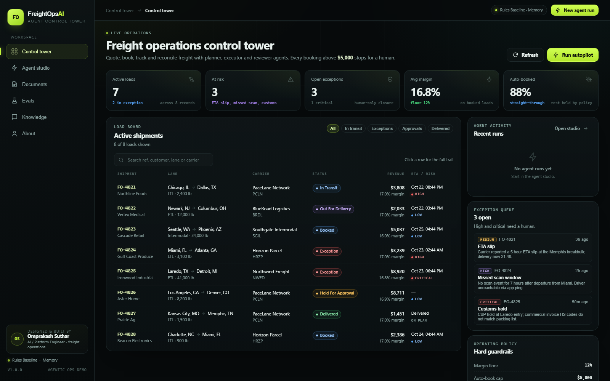
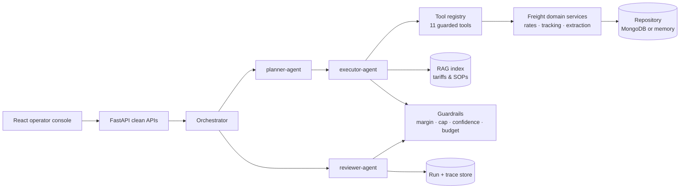

# FreightOps AI — Agent Control Tower

**Designed and built by Omprakash Suthar — AI / Platform Engineer, freight operations.**

**Live demo:** [freightops-ai.vercel.app](https://freightops-ai.vercel.app) · **Source:** [github.com/OPBSUTHAR/freightops-ai](https://github.com/OPBSUTHAR/freightops-ai)

A runnable multi-agent control tower for freight operations: quote → book → track → document intake → exception
resolution, with planner / executor / reviewer agents, retrieval over tariffs and SOPs, evals, traces, and hard
human-in-the-loop gates.

> No Claude, OpenAI or other subscription is required to run this build. The default agent runtime is a deterministic
> policy engine; an OpenAI-compatible adapter (GPT, Llama, Qwen, Groq, OpenRouter, Ollama) is included for model-proposed
> planning.



---

## What is in the box

| Area | Implemented here |
| --- | --- |
| Multi-agent workflows | Planner, executor, reviewer and five domain agents share a validated tool catalog and a persisted run state. |
| Freight operations | Lane pricing, carrier panel, quote drafting, tender/booking, tracking sync, ETA risk, exception playbooks. |
| Documents | BOL, invoice and packing-list extraction with per-field confidence, PII redaction and prompt-injection quarantine. |
| Retrieval | Dependency-free vector index over tariffs, accessorials, SOPs and approval policy; cited by quoting and triage. |
| Reliability | 9 behavioral evals, guardrails in code, per-step traces, latency and model spend telemetry. |
| UI | React operator console: load board, agent studio, document workbench, eval suite, retrieval explorer, about page. |

Synthetic data is seeded on first launch — 8 shipments, 3 quotes, 3 documents and 4 exceptions.

### Skill map

| Skill | Where it shows up |
| --- | --- |
| Agentic workflows | Planner → executor → reviewer over a validated tool registry. The loop is implemented directly (LangChain-style concepts, no framework lock-in) so every control-flow decision is inspectable. |
| LLMOps | Model routing, per-run spend cap, traces, 9 behavioral evals, deterministic fallback and a policy review gate. |
| Applied ML | Signed-hashing embeddings + vector retrieval, weighted ETA risk scoring, confidence-based extraction review. |
| MongoDB | Repository abstraction with an async MongoDB implementation and a zero-setup in-memory default. |
| Prompt engineering | Versioned prompts, JSON plan validation, prompt-injection quarantine and PII redaction. |
| Python / REST | FastAPI, typed Pydantic contracts, 8 API tests, clean JSON surface. |
| React | React 18 + Vite operator console with hash deep links into runs. |
| GitHub | Git history, `.gitignore`, setup scripts and CI-ready test commands. |
| Model choice | OpenAI-compatible adapter for GPT, Llama, Qwen, Groq, OpenRouter or Ollama. Claude is not required. |

---

## Quick start

Requirements: Python 3.11+ and Node 20+.

```powershell
# from the repository root
python -m venv .venv
.\.venv\Scripts\pip install -r backend\requirements.txt

# terminal 1 — API
cd backend
..\.venv\Scripts\python -m uvicorn app.main:app --reload --port 8000

# terminal 2 — UI
cd frontend
npm install
npm run dev
```

Open **http://localhost:5173**. The API docs are at **http://localhost:8000/docs**.

Or use the helper scripts:

```powershell
.\scripts\setup.ps1
.\scripts\dev.ps1
```

### Single-process mode

```powershell
cd frontend; npm run build
cd ..\backend
..\.venv\Scripts\python -m uvicorn app.main:app --port 8000
```

The API mounts `frontend/dist` at `/` when it exists, so the whole console runs on port 8000.

### Deploy on Vercel

The repo is Vercel-ready as a single project with two [services](https://vercel.com/docs/services): `console`
(Vite) and `api` (FastAPI). `vercel.json` routes `/api/*` to the backend and every other path to the console.

```powershell
npx vercel@latest deploy --prod
```

No environment variables are required for the rules baseline. The hosted demo uses the in-memory repository, and
Vercel Functions are ephemeral — demo records can reset on a cold start. Set `STORAGE=mongo` and `MONGODB_URI` for
durable state.

### Tests and evals

```powershell
cd backend
..\.venv\Scripts\python -m pytest -q          # 8 API tests
curl.exe -X POST http://localhost:8000/api/evals/run   # 9 agent evals
```

---

## Try these flows

1. **Autopilot with a human gate** — Agent studio → *Full autopilot* (LA → Denver, 8,200 lb). The booking exceeds the
   $5,000 auto-book cap, so the run pauses at `held_for_approval`. Approve it and the shipment becomes `booked`.
2. **Straight-through quote to booking** — "Quote and book Chicago, IL to Dallas, TX for 1,200 lbs" ends with an
   `approve` verdict, a booked load and a full trace.
3. **Invoice mismatch** — Documents → *Invoice - total mismatch* → Extract. Line items sum to $2,050 while the invoice
   states $2,414; the posting gate stays closed.
4. **Prompt injection** — Documents → *Injected BOL*. The instruction override is quarantined and the document is
   marked for human review.
5. **Exception guardrail** — Agent studio → *Exception sweep*. The agent resolves only low/medium exceptions; a
   customs hold refuses to close without a human.
6. **Retrieval** — Knowledge → ask "detention after two free hours"; the detention SOP is the top hit with a citation.

---

## Architecture



Key files:

```text
backend/app/
  agents/
    orchestrator.py   planner → executor → reviewer, run persistence, approval decisions
    planner.py        deterministic planner + LLM plan validation/fallback
    executor.py       step runner, retry, pause/skip semantics, traces
    reviewer.py       weighted policy audit and verdict
    tools.py          11 narrow, JSON-safe tool contracts
    llm.py            OpenAI-compatible adapter + cost estimation
    prompts.py        versioned planner/reviewer/extraction prompts
    evals.py          9-case behavioral suite (isolated stores)
  domain/
    rates.py          lane distance, carrier panel, quote construction
    tracking.py       scans, ETA risk, exception playbooks
  pipelines/
    extraction.py     BOL / invoice / packing-list fields, validations, OCR boundary
  guardrails.py       margin floor, auto-book cap, PII, injection, budgets
  rag/                corpus + signed-hashing vector index
  store.py            repository contract: memory or MongoDB (PyMongo async)
  api.py              REST surface
  seed.py             synthetic but internally consistent demo data
frontend/src/pages/   Overview · AgentStudio · Documents · Evals · Knowledge · About
```

### The agent loop

1. **Planner** turns a goal into the fewest safe tool calls. With `LLM_MODE=rules` it is deterministic; with a model
   configured, the proposed plan is validated against the tool catalog and silently falls back on any failure.
2. **Executor** calls tools, retries transient failures once, records latency and a trace per action. A blocked
   guardrail stops the run; a booking over the cap pauses it for a human.
3. **Reviewer** independently weights margin, carrier reliability, document completeness, open exceptions, execution
   integrity and spend. Verdicts: `approve`, `needs_approval`, `escalate`. It cannot approve around a guardrail.

### Tool catalog

`get_shipment`, `rate_lane`, `search_policy`, `draft_quote`, `check_guardrails`, `book_shipment`, `sync_tracking`,
`extract_document`, `post_invoice`, `list_exceptions`, `resolve_exception`.

Tools return JSON-safe dicts with a `summary` and optional `blocking`, `requires_approval`, `pause_run` or `stop_run`
flags. This is how policy becomes control flow instead of prompt advice.

### Guardrails (enforced in code)

| Guardrail | Default | Behavior |
| --- | --- | --- |
| Margin floor | 12% | Quote is blocked below the floor. |
| Auto-book cap | $5,000 sell | Booking is created `held_for_approval`; run pauses. |
| Carrier reliability | 0.85 | Below-floor carriers cannot be recommended or booked. |
| Document confidence | 0.85 | Low-confidence extraction requires human review. |
| Critical exceptions | — | Agent refuses to auto-close high/critical; API returns `409`. |
| Prompt injection | — | Document is quarantined and flagged `critical`. |
| Run spend | $0.25 | Run is escalated if model spend exceeds the cap. |
| PII | — | Email, phone, card and SSN patterns are redacted before extraction. |

---

## Configuration

Copy `.env.example` to `.env` (loaded from the repository root).

| Variable | Default | Notes |
| --- | --- | --- |
| `STORAGE` | `memory` | `mongo` enables the MongoDB repository. |
| `MONGODB_URI` | `mongodb://localhost:27017` | `pip install pymongo` for Mongo mode. |
| `LLM_MODE` | `rules` | `openai` for any OpenAI-compatible endpoint. |
| `LLM_BASE_URL` | `https://api.openai.com/v1` | Ollama: `http://localhost:11434/v1`. |
| `LLM_API_KEY` | empty | `ollama` for local Ollama. |
| `LLM_MODEL` | `gpt-4o-mini` | Planner / reviewer model. |
| `MIN_MARGIN_PCT` | `12` | Pricing floor. |
| `MAX_AUTO_BOOK_USD` | `5000` | Human approval threshold. |
| `DOC_CONFIDENCE_FLOOR` | `0.85` | Extraction review threshold. |
| `CARRIER_RELIABILITY_FLOOR` | `0.85` | Tender eligibility. |
| `RUN_BUDGET_USD` | `0.25` | Per-run model spend cap. |

Model routing is deliberately cost-aware: reasoning models for planning, small/deterministic paths for extraction, and
an auditable policy engine for review — never a sampled model for the final gate.

---

## API surface

| Method | Path | Purpose |
| --- | --- | --- |
| GET | `/api/health` | Storage, mode and version. |
| GET | `/api/meta` | Developer credit, agents, capabilities, policy, model routing. |
| GET | `/api/dashboard` | KPIs, shipments, exceptions, recent runs. |
| GET | `/api/shipments` · `/api/shipments/{ref}` | Load board and full shipment trail. |
| POST | `/api/quotes/rate` · `/api/quotes` | Price a lane / persist a quote. |
| POST | `/api/agents/run` | Execute planner → executor → reviewer. |
| GET | `/api/agents/runs` · `/api/agents/runs/{id}` | Run history and trace detail. |
| POST | `/api/agents/runs/{id}/approve` | Human approval or rejection. |
| GET/POST | `/api/documents`, `/api/documents/extract`, `/api/documents/upload` | Document ledger and ingestion. |
| GET/POST | `/api/exceptions`, `/api/exceptions/{id}/resolve` | Exception queue and guarded resolution. |
| GET | `/api/rag/search`, `/api/rag/stats` | Retrieval with scores. |
| POST | `/api/evals/run` | Behavioral suite. |
| POST | `/api/admin/reseed` | Reset demo data. |

---

## Design decisions

- **Policy in code, not prompts.** The reviewer and tool flags decide what can ship. Prompts can propose; they cannot
  authorize.
- **Model-agnostic by construction.** The deterministic baseline makes the demo reproducible and free; the LLM adapter
  is optional and always validated.
- **Repository abstraction.** The same API runs on in-memory documents for a zero-setup demo and MongoDB for a real
  deployment.
- **Evals as a release gate.** A prompt or model change is not "done" until `pytest` and the 9-case suite are green.
- **Human-in-the-loop as a first-class state.** `needs_approval` is persisted, visible and auditable — not a toast.

## Known limits (honest scope)

- Carrier rates, tracking scans and EDI payloads are synthetic. Real integrations belong behind the same domain/tool
  interfaces.
- OCR is an adapter boundary; text-layer PDFs and text files work now, scanned images need an OCR engine.
- The demo has no authentication — add SSO/RBAC before exposing it beyond localhost.
- The in-memory repository resets on restart; use `STORAGE=mongo` for persistence.

See [`docs/architecture.md`](docs/architecture.md) and [`docs/agentic-delivery.md`](docs/agentic-delivery.md) for deeper
notes.

---

<p align="center">
  <strong>FreightOps AI</strong> · designed and built by <strong>Omprakash Suthar</strong><br/>
  Planner · executor · reviewer agents with a human gate on every decision that matters.
</p>
